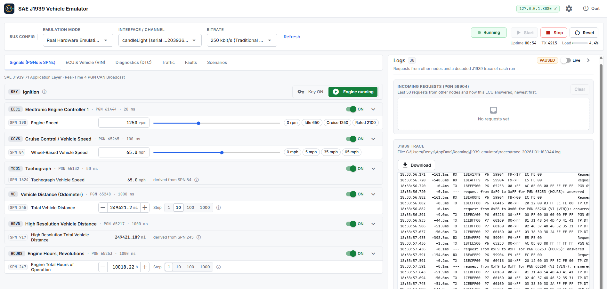
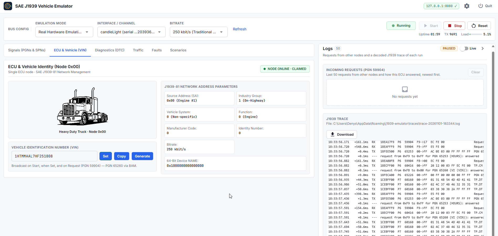
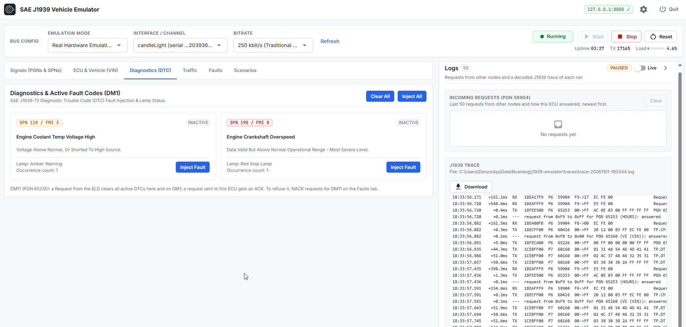
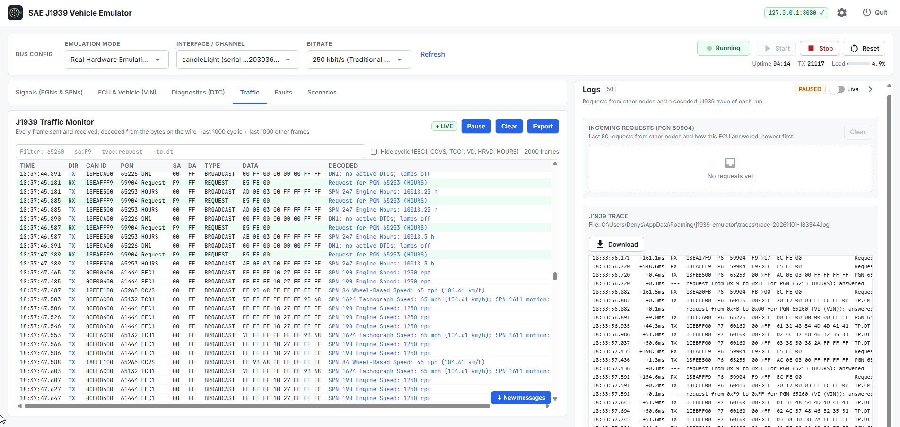
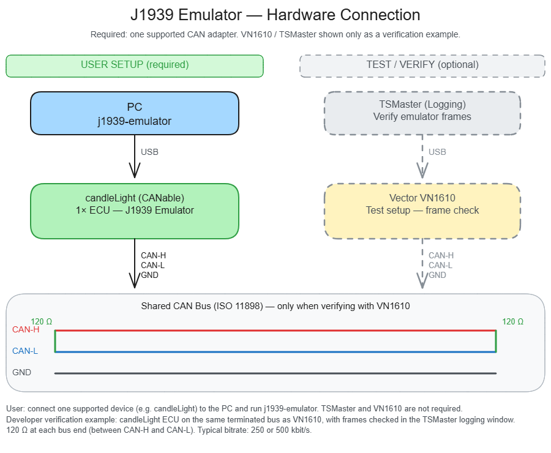

# SAE J1939 Vehicle Emulator

SAE J1939 vehicle ECU emulator for ELD and telematics QA.
It simulates engine speed, vehicle speed, odometer, engine hours, VIN, address claim and diagnostic faults on a **virtual** or **physical** CAN bus, so you can test an ELD on the bench without a truck.

Built with **python-can**, **can-j1939** and **NiceGUI**.



<table>
  <tr>
    <td width="33%"><a href="docs/screenshots/ecu_vehicle.png"></a></td>
    <td width="33%"><a href="docs/screenshots/dtc.png"></a></td>
    <td width="33%"><a href="docs/screenshots/traffic.png"></a></td>
  </tr>
  <tr>
    <td align="center">ECU &amp; Vehicle (VIN)</td>
    <td align="center">Diagnostics (DM1)</td>
    <td align="center">Traffic monitor</td>
  </tr>
</table>

**Requirements:** Python **3.11+** · Windows, Linux or macOS · a browser for the GUI (Chrome, Edge or Safari)

> **Bench use only.** The emulator transmits as the engine ECU (source address `0x00`). Do not connect it to the CAN bus of a real vehicle: it would conflict with the vehicle's own ECUs and can disturb their operation. Provided as is, without warranty (see [LICENSE](LICENSE)).

### What you get

| Area | Capability |
|------|------------|
| **Bus** | Real hardware auto-detect or Virtual (`vcan0` / `vcan1` / `vcan2`) · START / STOP / RESET · live TX stats |
| **Signals** | 6 cyclic PGNs with live controls and presets · odometer and engine hours count up automatically while running |
| **ECU / VIN** | Single node SA `0x00` · J1939-81 address claim (NAME: Industry Group 1 On-Highway, Function 0 Engine) · VIN on PGN 65260, `*`-terminated |
| **Requests** | Answers Request (PGN 59904), global or to SA `0x00`, for VIN and all broadcast PGNs |
| **Diagnostics** | Injectable DTCs on DM1 (PGN 65226), from the config (default SPN 110 / FMI 3 and SPN 190 / FMI 0) · DM11 (PGN 65235) from the ELD clears them |
| **UI** | Web GUI (default `http://127.0.0.1:8080`) or interactive CLI |

### Broadcast PGNs

| PGN | Name | CAN ID | Cycle | Signal (config key, unit) | Default |
|-----|------|--------|-------|---------------------------|---------|
| 61444 | EEC1: Electronic Engine Controller 1 | `0x0CF00400` | 20 ms | Engine Speed, SPN 190 (`eec1.spn190_rpm`, rpm) | 0 |
| 65265 | CCVS: Cruise Control / Vehicle Speed | `0x18FEF100` | 100 ms | Wheel-Based Vehicle Speed, SPN 84 (`ccvs.spn84_speed_mph`, mph) | 0 |
| 65132 | TCO1: Tachograph | `0x0CFE6C00` | 50 ms | Tachograph Vehicle Speed, SPN 1624 (same speed as CCVS), and Vehicle Motion, SPN 1611 | 0 |
| 65248 | VD: Vehicle Distance | `0x18FEE000` | 1000 ms | Total Vehicle Distance, SPN 245 (`vd.spn245_total_mi`, mi) | 248912.4 |
| 65217 | HRVD: High Resolution Vehicle Distance | `0x18FEC100` | 1000 ms | High Resolution Total Vehicle Distance, SPN 917 (same odometer as VD, 5 m resolution) | 248912.4 |
| 65253 | HOURS: Engine Hours, Revolutions | `0x18FEE500` | 1000 ms | Engine Total Hours of Operation, SPN 247 (`hours.spn247_engine_hours`, h) | 10000 |

All other SPNs in these PGNs are sent as *not available* (`0xFF`).

> Config files from before 2.0 used the key `spn917_total_mi`; it is still accepted.

### Ignition: key ON with the engine off

The **Ignition** card at the top of the Signals tab switches between **Engine running** and **Key ON · engine off**. With the key ON and the engine off, the ECU stays on the bus, claims its address and answers requests (VIN, odometer, engine hours), but EEC1, CCVS and TCO1 send 0 rpm and 0 mph and the meters stand still. Switching to **Engine running** sets Engine Speed to idle (650 rpm); switching to **Key ON · engine off** sets it to 0 rpm. It also works the other way: setting Engine Speed to 0 rpm switches to Key ON · engine off, and 600 rpm or more switches to Engine running. The Vehicle Speed setting is kept and sent again once the engine runs. In the CLI use `ignition on` / `ignition run`; in the config use `ignition` under `[vehicle]`.

Some ELDs only start asking the ECU for the VIN once they see the engine running. In that case the VIN stays empty in the app while the key is ON; the [requests and J1939 trace](#requests-and-j1939-trace) show whether the ELD sends any request at all.

### Automatic odometer and engine hours

While the ECU is running (after **START**):

- **Engine hours** (SPN 247) increase in real time whenever Engine Speed > 0 rpm.
- **Odometer** (total distance) increases by `vehicle speed × elapsed time`. For example, 60 mph for one minute adds 1 mile.

Both stop counting at 0 rpm / 0 mph and after **STOP**. You can set either value by hand at any time, and counting continues from the new value.

**Saved between runs.** Odometer and engine hours are stored per VIN (every 10 s while running, and on STOP / QUIT) and restored at the next launch, so each emulated truck keeps its own mileage. The saved values take priority over the config file; set a new value in the GUI or with `set` to change them. The file is `%APPDATA%\j1939-emulator\meters.json` on Windows and `~/.local/state/j1939-emulator/meters.json` on Linux/macOS. Turn this off with `persist_meters = false` under `[vehicle]`.

The CAN frames change in J1939 resolution steps: 0.05 h (3 minutes) for engine hours and 0.125 km (about 0.078 mi) for distance on VD, 5 m (about 0.003 mi) on HRVD.

---

## Hardware setup

One supported CAN adapter is enough to run the emulator.




**Tested on:** CANable / candleLight (candle / gs_usb, slcan), Vector VN1610

### Bench wiring checklist

A CAN frame is only delivered when at least one other node acknowledges (ACKs) it. Most ELDs connect to the truck in **listen-only** mode and never send an ACK. On a bench with just the adapter and an ELD, the emulator's frames may therefore never get through.

- Terminate the bus with **120 Ω at both ends**. With power off, CAN-H to CAN-L should measure about **60 Ω**.
- If the ELD is listen-only, add a third node in normal mode (a second adapter, or a Vector VN1610 / TSMaster) so frames get ACKed.
- J1939 9-pin Deutsch connector: **C = CAN-H**, **D = CAN-L**. Check that H and L are not swapped.
- The ELD and the emulator must use the same bitrate (most trucks use **250 kbit/s**, newer ones 500 kbit/s).
- Close other CAN tools (Cangaroo, TSMaster, etc.) that may hold the adapter before pressing **START**.

---

## 1. Clone and set up

Run every command from the **repository root** (`SAE-J1939-Vehicle-Emulator`), not from the inner `j1939_emulator` package folder.

### Windows PowerShell

```powershell
git clone https://github.com/denkuryshko/SAE-J1939-Vehicle-Emulator.git
cd SAE-J1939-Vehicle-Emulator

python -m venv .venv
.\.venv\Scripts\Activate.ps1
```

If activation fails with `running scripts is disabled`:

```powershell
Set-ExecutionPolicy -Scope CurrentUser RemoteSigned
.\.venv\Scripts\Activate.ps1
```

Or skip activation and call the venv Python directly, e.g. `.\.venv\Scripts\python.exe -m pip install …`.

### Windows Command Prompt (cmd.exe)

```bat
git clone https://github.com/denkuryshko/SAE-J1939-Vehicle-Emulator.git
cd SAE-J1939-Vehicle-Emulator

python -m venv .venv
.venv\Scripts\activate.bat
```

### Linux / macOS

```bash
git clone https://github.com/denkuryshko/SAE-J1939-Vehicle-Emulator.git
cd SAE-J1939-Vehicle-Emulator

python3 -m venv .venv
source .venv/bin/activate
```

---

## 2. Install

Stay in the repository root with the venv **activated**.

### Quick start (Virtual bus only)

```bash
python -m pip install --upgrade pip
python -m pip install -e .
```

This installs the app plus **can-j1939**, **nicegui**, **libusb-package** and a base **python-can**. On **Windows**, **pywin32** is installed too (required by can-j1939). Virtual Emulation works right away; no CAN adapter is needed.

### Full install (Real hardware adapters)

Use this for candleLight, Peak, Vector, etc. Vendor **OS drivers** are still required for those devices.

**Windows**

```powershell
python -m pip install --upgrade pip
python -m pip install -e . "python-can[gs-usb,serial,candle,pcan,neovi,canalystii,nixnet,seeedstudio,cvector,remote,sontheim,canine,zlgcan,viewer,mf4,multicast,pywin32]"
```

**Linux / macOS**

```bash
python -m pip install --upgrade pip
python -m pip install -e . "python-can[gs-usb,serial,candle,pcan,neovi,canalystii,nixnet,seeedstudio,cvector,remote,sontheim,canine,zlgcan,viewer,mf4,multicast]"
```

Optional CANtact support (needs [Rust](https://rustup.rs)):

```bash
python -m pip install "python-can[cantact]"
```

---

## 3. Run: GUI

```bash
python -m j1939_emulator --gui
```

The default browser opens at `http://127.0.0.1:8080`. To start from a config file:

```bash
python -m j1939_emulator --gui --config examples/ecu.toml
```

### Windows: `run_gui.bat` (recommended)

Double-click `run_gui.bat` (or put a shortcut to it on the desktop). It opens the GUI with `my_ecu.toml`, your own config next to the launcher; if it is not there yet, it is created from [`my_ecu.example.toml`](my_ecu.example.toml) (real adapter, 250 kbit/s, first adapter found). `my_ecu.toml` is ignored by git, so your adapter, VIN and bitrate stay local. On the first run, when there is no `.venv` yet, it finds Python 3.11+, creates `.venv` and installs everything including the candleLight driver, which takes about a minute. Keep the console window open while you work and stop with **QUIT** in the GUI, so meters are saved and the adapter is released.

`run_gui_no_console.bat` starts the same GUI without a console window (after the first run; before that it falls back to `run_gui.bat` for the setup). Its output, startup errors included, goes to `%APPDATA%\j1939-emulator\gui.log`. Stop it with **QUIT** in the GUI.

Other options: `--host` / `--port` to change the address, `--no-browser` to skip auto-open. You can also change **Host** / **Port** in **Settings** (the gear in the top bar) and click **Apply** (the UI restarts). **QUIT** stops the server.

> The GUI has no login. Keep the default host `127.0.0.1` (this computer only); with `0.0.0.0` or a LAN address anyone on the network can open it and control the emulator and the CAN adapter.

### Workflow

1. **Bus config:** choose **Virtual Emulation** (no hardware) or **Real Hardware Emulation**, then the channel and bitrate.
2. Click **START**. The ECU claims SA `0x00`, broadcasts the VIN and starts the cyclic PGNs.
3. **Signals** tab: drag sliders or use presets (e.g. Engine Speed **0 rpm / Idle 650 / Cruise 1250 / Rated 2100**). Odometer and engine hours count up on their own while running.
4. Click **Details** on any PGN card to see the technical data: PGN, CAN ID, cycle time (editable), live CAN payload, DLC and priority. The panels are collapsed by default.
5. **ECU & Vehicle (VIN)** tab: edit the VIN and click **Set** (rebroadcasts immediately), copy it, view NAME / SA. The chip shows when the node is claimed.
6. **Diagnostics** tab: inject or clear the DTCs from the config (sent on DM1 while running). Each card shows its lamp and occurrence count; the count goes up by one each time a DTC becomes active again. A DM11 request from the ELD (PGN 65235) clears all active DTCs; a request sent to SA 0x00 gets an ACK, a global one none. To test an ECU that refuses to clear, NACK or ignore requests for DM11 on the Faults tab.
7. Click **QUIT** when finished.

### Bus health indicator

While running, the status pill in the top bar watches the bus:

| Pill | Meaning |
|------|---------|
| **EMULATING · RUNNING** (green) | Frames are going out normally |
| **RUNNING · NO ACK** (amber) | Nobody acknowledges our frames: wiring, termination, or only listen-only nodes on the bus (see the [bench wiring checklist](#bench-wiring-checklist)) |
| **RUNNING · TX FAILING** (amber) | The adapter is not sending (TX timeouts) |
| **RUNNING · BUS ERRORS** (amber) | Error frames on the bus, e.g. a bitrate mismatch |

The footer shows **Other nodes**: how many other source addresses were heard on the bus in the last 3 seconds. A listen-only ELD does not transmit, so it is normal for this to stay at 0. The CLI `status` / `info` commands print the same as `bus=` and `peers=`.

NO ACK detection needs an adapter that reports error frames (candleLight / gs_usb, SocketCAN). Other adapters still show TX FAILING when sends time out.

### Requests and J1939 trace

The **Logs** panel on the right (below the tabs on narrow screens) is always visible, whatever tab is open, and has two parts for debugging an ELD on the bench:

- **Incoming Requests (PGN 59904)**: the last 50 requests from other nodes. Each row shows who asked, to which address (`0x00` or Global), which PGN, and what the emulator did: answered, answered after waiting for another BAM, NACK, ignored, or "not for this ECU".
- **J1939 Trace**: a decoded log of every frame exchanged, except the cyclic EEC1 / VD / HRVD / HOURS broadcasts. The vehicle speed broadcasts (CCVS, TCO1) are sampled into it: a line when the speed changes (at most once a second) and every 10 s while it stays the same, so the trace shows what speed the ELD was offered. It covers requests, address claims, transport frames from both sides (BAM, RTS, CTS, EOMA, Abort), completed multi-packet payloads (the VIN is shown as text), failed sends and bus-error summaries, all with millisecond times. **Download** saves the file.

The **Live** switch in the Logs header pauses the panel (it shows **PAUSED**) so a busy trace stops scrolling while you read it. Recording goes on: the trace file keeps every frame, and switching **Live** back on catches the panel up.

A new trace file is written on every START, and the last 20 are kept, in `%APPDATA%\j1939-emulator\traces\` on Windows and `~/.local/state/j1939-emulator/traces/` on Linux/macOS.

Example: an ELD asks the engine (`0x00`) for the VIN and gets a BAM back:

```text
18:41:19.755   +100.5ms  RX   18EA00F9  P6  59904  F9->00  EC FE 00                 Request for PGN 65260 (VI (VIN))
18:41:19.755     +0.0ms  TX   18ECFF00  P6  60416  00->FF  20 12 00 03 FF EC FE 00  TP.CM BAM: 18 bytes in 3 packets, PGN 65260 (VI (VIN))
18:41:19.755     +0.0ms  ---  request from 0xF9 to 0x00 for PGN 65260 (VI (VIN)): answered
18:41:19.821    +65.6ms  TX   1CEBFF00  P7  60160  00->FF  01 31 48 54 4D 4D 41 41  TP.DT packet #1
18:41:19.883    +62.2ms  TX   1CEBFF00  P7  60160  00->FF  02 4C 35 47 48 31 32 33  TP.DT packet #2
18:41:19.945    +62.1ms  TX   1CEBFF00  P7  60160  00->FF  03 34 35 36 2A FF FF FF  TP.DT packet #3 -> complete PGN 65260 (VI (VIN)): '1HTMMAAL5GH123456*'
```

If the ELD keeps repeating the request, answers with a TP.CM Abort, or sends a CTS that the emulator never asked for, it probably expects a different transport (for example RTS/CTS instead of BAM).

### Traffic monitor

The **Traffic** tab shows every frame on the bus as it happens, including all the cyclic EEC1 / CCVS / TCO1 / VD / HRVD / HOURS broadcasts that the trace file leaves out or samples. One row per frame: time, direction (TX / RX), CAN ID, PGN, source and destination address, type (BROADCAST, REQUEST, ACK / NACK, ADDRESS CLAIM, TP.CM BAM / RTS / CTS / EOMA / ABORT, TP.DT, ERROR), the raw data bytes and a **Decoded** column.

**Decoded** is read back from the bytes on the wire, not from the GUI settings, so it shows what an ELD actually receives: `SPN 190 Engine Speed: 800 rpm`, `SPN 84 Wheel-Based Speed: 35 mph (56.33 km/h)`, `SPN 245 Total Distance: 248912.4 mi (…km)`, `SPN 247 Engine Hours: 10000.05 h`, DM1 faults and lamps (`DM1: SPN 110 / FMI 3 (OC 1); lamps AWL`), requests, ACK / NACK, address claims and transport frames. The last TP.DT of a transfer also shows the whole reassembled message (`VIN 1HTMMAAL5GH123456`). J1939 special values come out as `not available` (0xFF…) or `error` (0xFE…).

**Filter** narrows the view as you type. Words separated by spaces must all match anywhere in the row; `-word` hides rows that contain it. Field filters: `pgn:65260`, `sa:F9`, `da:00`, `id:18EA`, `type:request`, `dir:rx`. Examples: `sa:f9` (everything the ELD sent), `type:request`, `-tp.dt -address`. **Hide cyclic** hides the EEC1 / CCVS / TCO1 / VD / HRVD / HOURS broadcasts so requests and replies stand out. The filter and the checkbox are remembered in the browser; the counter shows how many frames match.

**Export** saves the frames in memory as a candump log (`(time) can0 18EA00F9#ECFE00`), all of them whatever the filter, to the traces folder and as a browser download. Replay it with `canplayer`, or open it in SavvyCAN or Wireshark.

- The newest frame is at the bottom and the view follows it. Scroll up to read older frames and it stays put; **↓ New messages** jumps back to the newest.
- **Pause** freezes the view only (it shows **PAUSED**). The ECU keeps sending and answering. **Resume** continues from the newest frame and notes how many frames went by unseen.
- **Clear** empties the view only. The ECU, the counters and the trace file are not touched.
- The view keeps the last 1000 cyclic broadcasts and, separately, the last 1000 other frames, dropping the oldest first. The cyclic ones cover roughly the last 15–20 seconds at EEC1's 20 ms cycle; requests, replies and transport frames stay much longer, because the broadcasts can no longer push them out.

### Fault injection

The **Faults** tab makes the ECU misbehave on purpose, to check how an ELD copes with a missing, broken or slow engine ECU. Faults are runtime only: nothing is saved to the config, they survive STOP / START but not a restart of the app. Every change is written to the J1939 trace as a `FAULT …` line, so a trace file shows exactly when each fault started and ended.

| Fault | What the ELD sees | Typical check |
|-------|-------------------|---------------|
| **ECU silent** | Nothing at all from SA 0x00: no broadcasts, no replies, no DM1, no address claim. The ECU stays connected; requests are logged as ignored. | Engine synchronization / ECM connectivity malfunction |
| **Broadcast off** (per PGN) | EEC1, CCVS, TCO1, VD, HRVD or HOURS stops arriving; the others keep going. Requests for it are still answered. Also the **● ON / ○ OFF** pill on each card of the Signals tab. | Missing speed / odometer / engine hours |
| **SPN: not available / error** | `0xFF…` or `0xFE…` instead of the value, in broadcasts and replies alike. The card shows a red **SPN …: ERROR** chip. | Sensor missing or broken |
| **Requests: Ignore** | No reply; the ELD must time out and retry. | Request retry logic |
| **Requests: NACK** | A NACK (PGN 59392) even for a supported PGN. | Fallback when the ECU refuses |
| **Requests: Delay** | The reply after the set delay (200 ms … 10 s), with the data current at that moment. | Timeouts, late VIN |
| **Freeze odometer / engine hours** | The meter stops counting while the engine runs. | Driving with a stuck odometer |

Requests faults apply to **All PGNs** or one PGN (VIN, VD, HRVD, HOURS, EEC1, CCVS, TCO1, DM1, DM11). To make the odometer jump or run backwards use the ± buttons on the Signals tab; the VIN can be changed mid-trip on ECU & Vehicle.

While any fault is on, the Faults tab pill and the footer show how many; **ECU silent** also turns the top status amber (**ECU SILENT · FAULT INJECTED**) so it is not mistaken for a wiring problem. **Clear All Faults** puts everything back to normal.

### Scenarios

The **Scenarios** tab plays a timed test by itself: the truck drives with smooth, realistic acceleration and braking, faults come and go, the VIN changes. Pick a scenario, press **START** for the ECU, then **Run**. **Pause** freezes the scenario clock (the truck keeps the current speed), **Stop** ends it. The step list shows what has run, the current step and the time to the next one; the footer and the Signals tab show that a scenario is running, so a manual change is not a surprise when the next step overwrites it.

When a scenario ends (finished, stopped, the ECU stopped, or an error) all faults are cleared; the speed, rpm and meters stay where the scenario left them. Every step is written to the J1939 trace (`SCENARIO step 3 @1:30: …`), so the trace file of the run is the record of the test. Times are real: the ELD runs on its own clock, so a 30-minute test takes 30 minutes.

Built-in scenarios:

| Scenario | What it checks | Length |
|----------|----------------|--------|
| `drive-and-stop` | Idle → 5 → 35 → 65 mph → stop with the engine on for 6 min → engine off: automatic Driving, the stop prompt, meters counting | 11:45 |
| `ecu-disconnect` | ECU silent for 2 min while driving at 45 mph (change to 34 min for the 30-minute engine synchronization rule) | 6:15 |
| `sensor-failure` | Speed "not available", then "error"; odometer "not available" while driving | 6:15 |
| `truck-change` | Stop, power off, new VIN / odometer / engine hours, power on, drive; your VIN is restored at the end | 5:40 |
| `slow-ecu` | VIN requests delayed 3 s, then ignored, then NACKed, then normal; reconnect the ELD at each phase | 8:00 |

Your own scenarios: **Add file** in the tab (saved to `%APPDATA%\j1939-emulator\scenarios\` on Windows, `~/.local/state/j1939-emulator/scenarios/` on Linux/macOS), or put `.toml` files in that folder and press **Refresh**. A file is checked when it is selected and again on Run, so edits are picked up and a mistake is reported with the step and the key (`step 3: unknown key 'sped_mph'`) before anything happens.

Format:

```toml
name = "ECU disconnect while driving"
description = "Shown under the name in the tab"
# clear_faults_on_end = true     (default)
# restore_vin_on_end = false     (true: put back the VIN the ECU had before the scenario)

[[step]]
at = "0s"                        # time from the start: 500ms, 20s, 1m30s, 2h
ignition = "run"                 # "run" = engine running (idle), "on" = key ON, engine off

[[step]]
at = "20s"
ramp = { speed_mph = 45, rpm = 1450, over = "30s" }   # smooth by default; curve = "linear" for constant rate
note = "Text for the trace and the step list"

[[step]]
at = "2m"
fault = { silent = true }
```

Step actions (several may share one step):

| Key | Example | |
|-----|---------|-|
| `ignition` | `"run"` / `"on"` | Engine running at idle / key ON, engine off |
| `rpm`, `speed_mph` | `rpm = 1200`, `speed_mph = 35` | Set at once |
| `ramp` | `{ speed_mph = 0, rpm = 650, over = "30s" }` | Change gradually from the current value |
| `odometer_mi`, `engine_hours` | `odometer_mi = 512340.7` | Set a meter |
| `odometer_add_mi`, `engine_hours_add` | `odometer_add_mi = -10` | Jump a meter (negative = backwards) |
| `vin` | `vin = "3AKJHHDR1LSLA4213"` | New VIN, broadcast at once |
| `dtc` | `{ spn110_fmi3 = true, spn190_fmi0 = false }` | DM1 faults: `spn<SPN>_fmi<FMI>` of a DTC in the config (one that is not there is skipped and noted in the trace) |
| `fault` | `{ silent = true }`, `{ ccvs = false }`, `{ spn84 = "not_available" }`, `{ requests = { mode = "delay", pgn = "vin", delay = "3s" } }`, `{ freeze_odometer = true }` | Everything on the Faults tab: `silent`; `eec1` / `ccvs` / `tco1` / `vd` / `hrvd` / `hours` broadcast on/off; `spn190` / `spn84` / `spn1624` / `spn245` / `spn917` / `spn247` = `"normal"` / `"not_available"` / `"error"`; `requests` with `mode` = normal / ignore / nack / delay, `pgn` = number, `"vin"` or `"all"`, `delay`; `freeze_odometer`, `freeze_hours` |
| `clear_faults` | `true` | All faults back to normal |
| `note` | `"…"` | A line in the trace and the step list |

The CLI plays scenarios too: `scenario list`, `scenario run drive-and-stop`, `scenario` (status), `scenario pause | resume | stop`, or start with `--scenario drive-and-stop`.

### Bus modes

| Mode | Channels | Hardware |
|------|----------|----------|
| **Virtual Emulation** | `vcan0`, `vcan1`, `vcan2` (python-can software bus) | Not required |
| **Real Hardware Emulation** | Detected adapters (candleLight, Vector VN1610, …) | Adapter must be plugged in; unplugged devices do not appear |

---

## 4. Run: CLI

```bash
python -m j1939_emulator --config examples/ecu.toml
```

By default this uses the Virtual channel `vcan0` at 500 kbit/s (see `examples/ecu.toml`) and starts immediately. Odometer and engine hours count in CLI mode too.

### Choosing a channel

List adapters, then pass the **number** to `--channel`:

```bash
python -m j1939_emulator --list-channels --mode real
python -m j1939_emulator --config examples/ecu.toml --mode real --channel 1 --bitrate 250000
```

Example output:

```text
Available Real CAN channels (3):

  #   Adapter
  --  -----------------------------------------------
  1   candleLight  (serial ...20393630)
  2   serial  ch=COM5
  3   serial  ch=COM8
```

A list number depends on which adapters are plugged in (unplug the candleLight and `1` becomes a COM port). For a fixed setup, put the adapter's own channel string in the config instead. For candleLight that is its serial number, e.g. `channel = "003A002B5946570920393630:0"`. If the configured adapter is missing, the GUI selects nothing and warns, instead of falling back to another device.

For Virtual mode you can also use the names `vcan0`, `vcan1`, `vcan2`. Use `--no-start` to open the prompt without starting emulation.

### Commands at the `>` prompt

| Command | Meaning |
|---------|---------|
| `channels [real\|virtual]` | List adapters; note the **#** to use with `--channel` / `channel` |
| `channel [N]` | Show the current channel or select one by number |
| `mode [real\|virtual]` | Show or change emulation mode |
| `bitrate [Hz]` | Show or set bitrate (`125000` … `1000000`) |
| `info` | Dump runtime config as `key=value` (for scripts and automation) |
| `status` / `payloads` | Live stats / current PGN hex |
| `get <key>` / `set <key> <value>` | Read / change a signal (keys below) |
| `vin [value]` | Show or set the VIN (rebroadcasts PGN 65260 if running) |
| `ignition [on\|run]` | Show or set the ignition: `on` = key ON, engine off; `run` = engine running |
| `dtc` | List the configured DTCs and which are active |
| `dtc <n\|spnX_fmiY\|all> on\|off` | Inject / clear DM1 faults (`n` = number in the list) |
| `requests [clear]` | Requests received from other nodes and how they were answered |
| `trace [N]` | Last N lines (default 40) of the [J1939 trace](#requests-and-j1939-trace) and its file path |
| `stop` / `start` / `reset` / `help` / `quit` | Session control |

Signal keys for `get` / `set`:

```text
eec1.spn190_rpm             set eec1.spn190_rpm 650
ccvs.spn84_speed_mph        set ccvs.spn84_speed_mph 65
vd.spn245_total_mi          set vd.spn245_total_mi 250000
hours.spn247_engine_hours   set hours.spn247_engine_hours 12000
eec1.cycle_ms, ccvs.cycle_ms, tco1.cycle_ms, vd.cycle_ms, hrvd.cycle_ms, hours.cycle_ms
```

---

## 5. Config file

See [`examples/ecu.toml`](examples/ecu.toml) (Virtual) and [`my_ecu.example.toml`](my_ecu.example.toml) (real adapter at 250 kbit/s). All fields:

```toml
[bus]
mode = "virtual"          # "real" | "virtual"
channel = "vcan0"         # vcan0/1/2, a list number from --list-channels, or e.g. "<candleLight serial>:0"
bitrate = 500000          # 125000 | 250000 | 500000 | 1000000
start_on_launch = true    # CLI: start immediately

[ecu]
source_address = 0x00
# J1939-81 NAME (claimed on the bus), built from these fields:
industry_group = 1        # 1 = On-Highway
vehicle_system = 0        # 0 = Non-specific
function = 0              # 0 = Engine
manufacturer_code = 0
identity_number = 0
# Optional instead: name = 0x1000000000000000 (full 64-bit NAME; fields above override it)

[vehicle]
vin = "1HTMMAAL5GH123456"
persist_meters = true    # keep odometer / engine hours per VIN between runs
ignition = "run"         # "run" = engine running | "on" = key ON, engine off (0 rpm / 0 mph)

# DTCs the Diagnostics tab can inject. Leave the list out to get the two below.
[[diagnostics.dtc]]
spn = 110
fmi = 3
lamp = "amber"            # amber | red | mil | protect
name = "Engine Coolant Temp Voltage High"
description = "Voltage Above Normal, Or Shorted To High Source."
oc = 1                    # occurrence count (0-126)
active = false            # injected at START

[[diagnostics.dtc]]
spn = 190
fmi = 0
lamp = "red"
name = "Engine Crankshaft Overspeed"

[pgn.eec1]
enabled = true
cycle_ms = 20
spn190_rpm = 0

[pgn.ccvs]
enabled = true
cycle_ms = 100
spn84_speed_mph = 0

[pgn.tco1]                     # sends the [pgn.ccvs] speed as tachograph speed
enabled = true
cycle_ms = 50

[pgn.vd]
enabled = true
cycle_ms = 1000
spn245_total_mi = 248912.4   # starting odometer, miles

[pgn.hrvd]                     # sends the [pgn.vd] odometer at 5 m resolution
enabled = true
cycle_ms = 1000

[pgn.hours]
enabled = true
cycle_ms = 1000
spn247_engine_hours = 10000.0   # starting engine hours
```

Older configs switch the built-in DTCs with `dtc_spn110_fmi3 = true` / `dtc_spn190_fmi0 = true` under `[diagnostics]`; that still works, also as `dtc_spn<SPN>_fmi<FMI>` for any DTC in the list.

Every `[pgn.*]` section is optional; missing values use the defaults from the table above. Set `enabled = false` to stop broadcasting a PGN.

---

## Troubleshooting

| Symptom | Likely cause / fix |
|---------|--------------------|
| Status pill shows **NO ACK** / ELD sees nothing | No node ACKs the frames. See the [bench wiring checklist](#bench-wiring-checklist): termination, a third ACKing node, H/L wiring, bitrate. |
| Odometer / engine hours start from an old value | They are restored per VIN from `meters.json`. Set a new value in the GUI, or use `persist_meters = false`. |
| ELD sees engine data but no VIN | The ELD must be able to receive multi-packet BAM (PGN 60416 / 60160). VIN is broadcast on START and on **Set**, and sent again whenever the ELD requests PGN 65260. Check the [requests and J1939 trace](#requests-and-j1939-trace): whether the request arrives, to which address, and how the ELD reacts to the BAM. |
| `START failed` / `Cannot open device` | Another program holds the adapter, or the USB device has not been released yet. Close other CAN tools, wait a second and press START again. |
| Port 8080 already in use | `python -m j1939_emulator --gui --port 8090` |
| Adapter not listed | Check the vendor driver and USB cable, then click **Refresh** (GUI) or run `channels real` (CLI). |

---

## Tests

```bash
python -m pip install -e ".[dev]"
python -m pytest
```

The tests cover PGN / VIN / DM1 / NAME encoding, config loading and meter persistence, and run the emulator end to end on python-can's virtual bus against a fake ELD node (requests, NACK, DM1, bus health). No CAN hardware is needed.

---

## License

MIT, see [LICENSE](LICENSE). Based on the original j1939-emulator by Embedded Verse (MIT).
